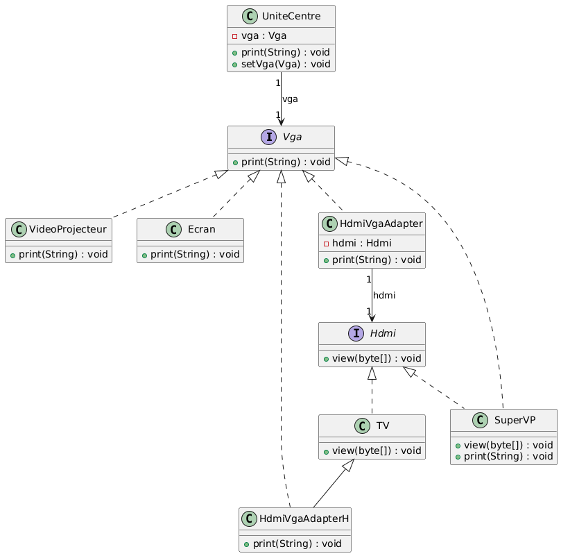
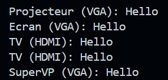

# Rapport de Travaux Pratiques : Design Pattern Adapter
 
**Encadrant :** Mohamed YOUSSFI  
**Étudiant :** Youness HATTABI

---

## Table des Matières

1. [Introduction](#1-introduction)
2. [Présentation du pattern](#2-présentation-du-pattern)
   - 2.1 [Problème posé](#21-problème-posé)
   - 2.2 [Solution proposée](#22-solution-proposée)
   - 2.3 [Acteurs du pattern](#23-acteurs-du-pattern)
3. [Diagramme de classes](#3-diagramme-de-classes)
4. [Implémentation](#4-implémentation)
   - 4.1 [Les interfaces `Vga` et `Hdmi`](#41-les-interfaces-vga-et-hdmi)
   - 4.2 [Le client `UniteCentre`](#42-le-client-unitecentre)
   - 4.3 [Les périphériques VGA natifs](#43-les-périphériques-vga-natifs)
   - 4.4 [Le périphérique HDMI `TV`](#44-le-périphérique-hdmi-tv)
   - 4.5 [Le périphérique `SuperVP`](#45-le-périphérique-supervp)
   - 4.6 [L'adaptateur d'objet `HdmiVgaAdapter`](#46-ladaptateur-dobjet-hdmivgaadapter)
   - 4.7 [L'adaptateur de classe `HdmiVgaAdapterH`](#47-ladaptateur-de-classe-hdmivgaadapterh)
5. [Tests et Résultats](#5-tests-et-résultats)
6. [Adaptateur d'objet vs adaptateur de classe](#6-adaptateur-dobjet-vs-adaptateur-de-classe)
7. [Conclusion](#8-conclusion)

---

## 1. Introduction

Le pattern **Adapter** est un pattern de conception _structurel_. Il permet à des classes dont les interfaces sont incompatibles de collaborer, en introduisant un intermédiaire qui traduit les appels d'une interface vers l'autre.

Ce rapport l'illustre avec un exemple de connectique : une unité centrale qui ne sait communiquer qu'en **VGA** doit pouvoir afficher sur une télévision qui ne comprend que le **HDMI**.

---

## 2. Présentation du pattern

### 2.1 Problème posé

Une classe cliente (`UniteCentre`) dépend d'une interface `Vga`. Une classe existante (`TV`) offre le service attendu, mais via une interface différente (`Hdmi`). On ne souhaite modifier ni le client, ni la classe existante, qui peut provenir d'une bibliothèque tierce.

### 2.2 Solution proposée

On crée une classe **adaptateur** qui implémente l'interface attendue par le client (`Vga`) et traduit chaque appel vers l'interface de la classe existante (`Hdmi`). Le diagramme présente deux variantes :

- **L'adaptateur d'objet** (`HdmiVgaAdapter`) : il _contient_ un `Hdmi` (composition).
- **L'adaptateur de classe** (`HdmiVgaAdapterH`) : il _hérite_ de `TV` (héritage).

### 2.3 Acteurs du pattern

| Rôle                | Classe / Interface                  | Responsabilité                       |
| ------------------- | ----------------------------------- | ------------------------------------ |
| Client              | `UniteCentre`                       | Utilise uniquement l'interface `Vga` |
| Interface cible     | `Vga`                               | Interface attendue par le client     |
| Interface adaptée   | `Hdmi`                              | Interface de la classe existante     |
| Classes compatibles | `VideoProjecteur`, `Ecran`          | Implémentent directement `Vga`       |
| Classe à adapter    | `TV`                                | Implémente `Hdmi`                    |
| Adaptateurs         | `HdmiVgaAdapter`, `HdmiVgaAdapterH` | Traduisent `Vga` vers `Hdmi`         |
| Classe bi-interface | `SuperVP`                           | Implémente à la fois `Vga` et `Hdmi` |

---

## 3. Diagramme de classes

**Diagramme UML généré depuis IntelliJ IDEA :**



Lecture du diagramme :

- `UniteCentre` possède un attribut `vga` de type `Vga` (association).
- `VideoProjecteur`, `Ecran`, `HdmiVgaAdapter`, `HdmiVgaAdapterH` et `SuperVP` **implémentent** `Vga`.
- `TV` et `SuperVP` **implémentent** `Hdmi`.
- `HdmiVgaAdapter` possède un attribut `hdmi` de type `Hdmi` (adaptateur d'objet).
- `HdmiVgaAdapterH` **hérite** de `TV` (adaptateur de classe).

**Organisation du projet :**

```
src/main/java/
├── adapter/
│   ├── Vga.java
│   ├── Hdmi.java
│   ├── UniteCentre.java
│   ├── VideoProjecteur.java
│   ├── Ecran.java
│   ├── TV.java
│   ├── SuperVP.java
│   ├── HdmiVgaAdapter.java
│   └── HdmiVgaAdapterH.java
└── hattabi/youness/Main.java
```

---

## 4. Implémentation

### 4.1 Les interfaces `Vga` et `Hdmi`

Les deux interfaces représentent des standards de connectique incompatibles : l'une reçoit du texte, l'autre des octets.

```java
package adapter;

public interface Vga {
    void print(String text);
}
```

```java
package adapter;

public interface Hdmi {
    void view(byte[] data);
}
```

---

### 4.2 Le client `UniteCentre`

Le client ne dépend que de l'interface `Vga`. Le périphérique est injecté par `setVga`, ce qui permet de le changer à l'exécution.

```java
package adapter;

public class UniteCentre {
    private Vga vga;

    public void setVga(Vga vga) {
        this.vga = vga;
    }

    public void print(String text) {
        vga.print(text);
    }
}
```

---

### 4.3 Les périphériques VGA natifs

`VideoProjecteur` et `Ecran` implémentent directement `Vga`. Ils n'ont pas besoin d'adaptateur.

```java
package adapter;

public class VideoProjecteur implements Vga {
    @Override
    public void print(String text) {
        System.out.println("Projecteur (VGA): " + text);
    }
}
```

```java
package adapter;

public class Ecran implements Vga {
    @Override
    public void print(String text) {
        System.out.println("Ecran (VGA): " + text);
    }
}
```

---

### 4.4 Le périphérique HDMI `TV`

`TV` est la classe incompatible avec le client : elle n'expose que `view(byte[])`.

```java
package adapter;

public class TV implements Hdmi {
    @Override
    public void view(byte[] data) {
        System.out.println("TV (HDMI): " + new String(data));
    }
}
```

---

### 4.5 Le périphérique `SuperVP`

`SuperVP` supporte nativement les deux standards, il peut donc être branché directement sur l'unité centrale.

```java
package adapter;

public class SuperVP implements Vga, Hdmi {
    @Override
    public void view(byte[] data) {
        System.out.println("SuperVP (HDMI): " + new String(data));
    }

    @Override
    public void print(String text) {
        System.out.println("SuperVP (VGA): " + text);
    }
}
```

---

### 4.6 L'adaptateur d'objet `HdmiVgaAdapter`

Il implémente `Vga` et détient un `Hdmi`. Il convertit le `String` reçu en `byte[]` avant de déléguer à `view`.

```java
package adapter;

public class HdmiVgaAdapter implements Vga {
    private Hdmi hdmi;

    public HdmiVgaAdapter(Hdmi hdmi) {
        this.hdmi = hdmi;
    }

    @Override
    public void print(String text) {
        hdmi.view(text.getBytes());
    }
}
```

---

### 4.7 L'adaptateur de classe `HdmiVgaAdapterH`

Il hérite de `TV` et implémente `Vga`. Au lieu de détenir un `TV`, il _est_ un `TV` et appelle directement sa méthode héritée `view`.

```java
package adapter;

public class HdmiVgaAdapterH extends TV implements Vga {
    @Override
    public void print(String text) {
        view(text.getBytes());
    }
}
```

---

## 5. Tests et Résultats

Le code client reste identique : seul l'objet passé à `setVga` change.

```java
package hattabi.youness;

import adapter.*;

public class Main {
    public static void main(String[] args) {
        UniteCentre uc = new UniteCentre();

        uc.setVga(new VideoProjecteur());
        uc.print("Hello");

        uc.setVga(new Ecran());
        uc.print("Hello");

        uc.setVga(new HdmiVgaAdapter(new TV()));
        uc.print("Hello");

        uc.setVga(new HdmiVgaAdapterH());
        uc.print("Hello");

        uc.setVga(new SuperVP());
        uc.print("Hello");
    }
}
```

**Sortie attendue :**

```
Projecteur (VGA): Hello
Ecran (VGA): Hello
TV (HDMI): Hello
TV (HDMI): Hello
SuperVP (VGA): Hello
```

**Capture de l'exécution :**



Les deux lignes `TV (HDMI)` proviennent des deux types d'adaptateurs et produisent le même résultat. `UniteCentre` ignore qu'elle communique avec un périphérique HDMI.

---

## 6. Adaptateur d'objet vs adaptateur de classe

|                 | `HdmiVgaAdapter`                | `HdmiVgaAdapterH`                   |
| --------------- | ------------------------------- | ----------------------------------- |
| Mécanisme       | Composition (détient un `Hdmi`) | Héritage (étend `TV`)               |
| Compatible avec | Toute implémentation de `Hdmi`  | `TV` et ses sous-classes uniquement |
| Flexibilité     | Élevée, généralement préféré    | Plus faible, lié à une classe       |

---

## 7. Conclusion

Ce travail a permis d'implémenter le pattern Adapter sous ses deux formes. Il montre comment intégrer une classe dotée d'une interface incompatible dans un système existant, tout en laissant le code client inchangé.
